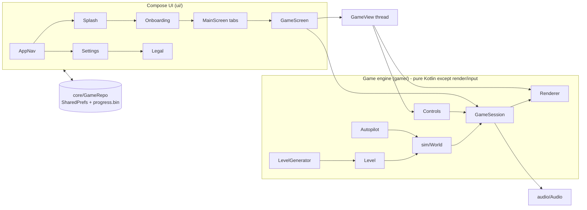

# Inch Perfect: Car Parking: developer guide

A top-down 2.5D car-parking game for Android:
- **10,000 levels.** Each one is generated from its level number and verified by an automated test drive.
- **58 cars, 34 steering wheels.**
- **Fully offline.** Kotlin + Jetpack Compose for menus, plus a custom 2D engine on a `SurfaceView`.
- **No third-party game engine, no downloaded art or sound.** Every car, texture, icon, sound effect and music loop is generated by code in this repository.

> Package: `com.ngstudio.inchperfect` · minSdk 24 · target/compile SDK 37 · landscape only

Design history lives in `docs/`: [v1 plan](docs/BUILD_SCRIPT.md), [v2 "Showroom"](docs/BUILD_SCRIPT_V2.md), [v3 "Feel"](docs/BUILD_SCRIPT_V3.md).

---

## Contents
1. [Quick start](#1-quick-start)
2. [Build types and flags](#2-build-types-and-flags)
3. [Architecture at a glance](#3-architecture-at-a-glance)
4. [Source map (every file)](#4-source-map)
5. [Core systems explained](#5-core-systems-explained)
6. [How-to recipes](#6-how-to-recipes)
7. [Rules you must not break](#7-rules-you-must-not-break)
8. [Testing](#8-testing)
9. [Assets, licences and store art](#9-assets-licences-and-store-art)
10. [Known TODOs](#10-known-todos)

---

## 1. Quick start

**Requirements:** Android Studio (AGP 9.4), JDK 21, Android SDK 37. Gradle 9.6 comes with the wrapper.

```bash
./gradlew assembleDebug
```

```bash
./gradlew installDebug
```

```bash
./gradlew testDebugUnitTest
```

The last command runs every JVM test, including the full 10,000-level proof (about 1 minute).

**Output:**
- Debug APK: `app/build/outputs/apk/debug/app-debug.apk` (about 13 MB).
- Release APK: `app/build/outputs/apk/release/app-release.apk` (about 2.3 MB after R8).

**Useful test commands:**

Prove a range or list of levels:

```bash
./gradlew testDebugUnitTest --tests '*LevelSuiteTest.allLevelsAreSolvable' -Plevels=1-500
```

Render top-down PNG previews of levels (with the autopilot's actual trajectory drawn on) into `app/build/previews/`:

```bash
./gradlew testDebugUnitTest --tests '*LevelPreviewTest*' -Ppreview=1-10,57,9999
```

---

## 2. Build types and flags

Set in `app/build.gradle.kts`:

| Flag | debug | release | Effect |
|---|---|---|---|
| `BuildConfig.ADS_SIMULATED` | `true` | `false` | `true`: every locked item and level shows **WATCH AD**, and a fake 1.5 s "ad" grants it. `false`: ad buttons are hidden, and locked levels say "Finish level N−1 first". |
| `BuildConfig.DEBUG_TOOLS` | `true` | `false` | Shows the magenta **AI** button in the game HUD (autopilot plays the level). |

Release builds are minified with R8 and, **for local testing only**, signed with the debug key. Replace `signingConfig` with your Play upload key before publishing.

---

## 3. Architecture at a glance



**Threads:**
- **Main thread:** Compose UI and touch delivery.
- **`inch-perfect-game` thread** (in `GameView`): runs `GameSession.update`, then `Renderer.draw` and `Controls.draw` on a hardware canvas every frame.
- **`engine-audio` thread:** streams the live engine synth into an `AudioTrack`.
- **Background executors:** level generation and texture warm-up on `Dispatchers.Default`, plus progress-file writes and audio rendering.

**Data flow in a level:**
1. Touch goes to `Controls` (writes `ControlState`).
2. `GameSession.update` steps `World` at a fixed 120 Hz.
3. `World` reports events (crash, cone, coin, parked) back to `GameSession`, which spawns particles, plays sound and haptics, and publishes a `Hud` snapshot through a `StateFlow`.
4. Compose draws the HUD and dialogs over the `SurfaceView`.

---

## 4. Source map

Kotlin sources live under `app/src/main/java/com/ngstudio/inchperfect/`; every entry below links to its file.

### App shell
| File | What it does |
|---|---|
| [InchPerfectApp.kt](app/src/main/java/com/ngstudio/inchperfect/InchPerfectApp.kt) | `Application`. Initialises `GameRepo`, `Haptics`, `Audio` (starts rendering sounds) and the texture disk cache. |
| [MainActivity.kt](app/src/main/java/com/ngstudio/inchperfect/MainActivity.kt) | Single activity. Splash API, immersive full-screen, keep-screen-on, font-scale cap (1.15×), keyboard input (WASD / arrows / Space / Q-E) and the accelerometer for tilt steering. |

### `core/`: state, economy, meta-game
| File | What it does |
|---|---|
| [core/GameRepo.kt](app/src/main/java/com/ngstudio/inchperfect/core/GameRepo.kt) | **Single source of truth for saved data**, exposed as `StateFlow`s. `Settings`, `Profile` (coins, owned and selected cars, wheels, paints, skins, themes, boosters, daily/spin state), `Stats`. Level stars and best times for 10,000 levels sit in `progress.bin` (atomic write on a background thread). Also: unlock rules (`isUnlocked`, `unlockByAd`), `recordWin`, wallet helpers, `sanitize()` for retired items. |
| [core/Economy.kt](app/src/main/java/com/ngstudio/inchperfect/core/Economy.kt) | All prices and rewards: level reward formula, paints, finishes, decals, underglow, boosters, chest, login calendar, spin-wheel prizes, rank titles, UI themes (`UiThemes`). |
| [core/Meta.kt](app/src/main/java/com/ngstudio/inchperfect/core/Meta.kt) | Daily missions (`Missions`, rolled per day), 30 achievements (`Achievements`), `Haptics` (respects the setting). |

### `ads/`
| File | What it does |
|---|---|
| [ads/RewardedAds.kt](app/src/main/java/com/ngstudio/inchperfect/ads/RewardedAds.kt) | `RewardedAds` interface + `SimulatedRewardedAds` (debug) + `DisabledRewardedAds` (release). `Ads.rewarded` picks one by `ADS_SIMULATED`. `Placement` enumerates every ad slot. **Plug AdMob in here** (see §6). |

### `audio/`: 100% synthesised
| File | What it does |
|---|---|
| [audio/Synth.kt](app/src/main/java/com/ngstudio/inchperfect/audio/Synth.kt) | Tiny offline synth: oscillators, envelopes, noise, filters, echo, normalise, WAV writer. |
| [audio/SoundBank.kt](app/src/main/java/com/ngstudio/inchperfect/audio/SoundBank.kt) | Recipes for 24 effects (`Sfx`) and 3 eight-bar music loops (`Track` MENU / GAME / NIGHT). Rendered once into `cacheDir/audio/*_v{VERSION}.wav`. Bump `VERSION` to force a re-render. |
| [audio/Audio.kt](app/src/main/java/com/ngstudio/inchperfect/audio/Audio.kt) | Playback: `SoundPool` for effects, `MediaPlayer` for looping music with cross-fades, and a live **engine synth** (`AudioTrack`) driven by `rpm`, `throttle` and `speed` with a per-car `EngineSound` profile. |

### `game/math/`
| File | What it does |
|---|---|
| [game/math/Geo.kt](app/src/main/java/com/ngstudio/inchperfect/game/math/Geo.kt) | `M` (StrictMath wrappers for determinism), `Pose`, `Box` / `Disc` shapes, `Collide` (SAT overlap + distances), `Rng` (PCG32). World units are metres, **y points down**, heading 0 = +x. |

### `game/physics/`
| File | What it does |
|---|---|
| [game/physics/Cars.kt](app/src/main/java/com/ngstudio/inchperfect/game/physics/Cars.kt) | `CarSpec` (dimensions, steering, acceleration, price) and the **58-car catalogue** `Cars.ALL`. `Cars.REF` is the reference car that every level is proven with. `CarState`, `DriveInput`, `CarPhysics.step` (kinematic bicycle model, creep, braking, ice drift, trailer). |
| [game/physics/CarDesign.kt](app/src/main/java/com/ngstudio/inchperfect/game/physics/CarDesign.kt) | Visual-only description of each car (cabin position, roof type, hood, rear wing or bed, lamps, trim…) with presets per `Category`. |

### `game/level/`: 10,000 levels
| File | What it does |
|---|---|
| [game/level/Level.kt](app/src/main/java/com/ngstudio/inchperfect/game/level/Level.kt) | Level data model: obstacles (`ObKind`, solid or soft), props, markings, ground zones, traffic lanes, rising bollards, turntables, coins, lighting, weather, the reference solution (`Step`s), star times. `Mech` = gameplay mechanics, with their "NEW!" card text. |
| [game/level/Difficulty.kt](app/src/main/java/com/ngstudio/inchperfect/game/level/Difficulty.kt) | **Difficulty curves:** `tightness(n)` (clearances, angle tolerance, star time) and `complexity(n)` (segments, mechanics). `TUTORIAL_LEVELS = 5`. `Difficulty.INTRO` = the level each mechanic is introduced. `Districts` = 20 themed districts of 500 levels. |
| [game/level/Builder.kt](app/src/main/java/com/ngstudio/inchperfect/game/level/Builder.kt) | Path-first construction kit. Drives the reference car along motion primitives, records the swept area, then **slides obstacles towards the path until they sit exactly `clearance` metres away**. |
| [game/level/Gen.kt](app/src/main/java/com/ngstudio/inchperfect/game/level/Gen.kt) | Level templates: lead-in segments (`Seg`: straight, corner, S-bend, slalom, hairpin, traffic crossing, bollard gate, tight 3-point turn, ice, turntable) and parking finales (`Final`: forward/reverse bay, angled, parallel, garage, dock, pillars, trailer). Decoration, coins, bounds and the reference time. |
| [game/level/LevelGenerator.kt](app/src/main/java/com/ngstudio/inchperfect/game/level/LevelGenerator.kt) | Entry point: `LevelGenerator.level(n)` (LRU-cached) and `generate(n)`. Holds the handcrafted plans for levels 1–5, the per-level `plan()` (archetype, mechanics, lighting, weather, district walls), `Validator.quick`, and `Transform.rotate` (quarter-turn variety). |

### `game/sim/`
| File | What it does |
|---|---|
| [game/sim/World.kt](app/src/main/java/com/ngstudio/inchperfect/game/sim/World.kt) | Runtime simulation of one level: physics stepping, collisions (static broadphase `StaticIndex`, traffic, bollards, trailer jack-knife), cone tumbling, coins, turntables, parking sensors, the **parked check** (whole car in the bay, heading within tolerance, stopped 0.5 s), precision %, and **rewind snapshots**. |
| [game/sim/Autopilot.kt](app/src/main/java/com/ngstudio/inchperfect/game/sim/Autopilot.kt) | Drives a level's verified reference solution through the real physics. Used by the tests, the debug **AI** button and the Ghost Guide. Steering is scaled by curvature so **every car** follows the same path. Waits for traffic and bollard gaps with a look-ahead probe. |

### `game/` (session, view, input)
| File | What it does |
|---|---|
| [game/GameSession.kt](app/src/main/java/com/ngstudio/inchperfect/game/GameSession.kt) | One play-through: state machine (INTRO → PLAYING ⇄ PAUSED → CRASHED / PARKED), fixed-step loop, stars, boosters (rewind, ghost, slow-mo), free rewind on tutorial levels, hit-stop and tiered shake, body dive/squat, particles and skid marks, tutorial hints, crash cause, the `Hud` StateFlow. Also `ControlState` (thread-safe input). |
| [game/GameView.kt](app/src/main/java/com/ngstudio/inchperfect/game/GameView.kt) | `SurfaceView` + game thread. Frame pacing (30/60/90), FPS log (`IPPerf` tag), auto-quality drop on slow devices. |
| [game/input/Controls.kt](app/src/main/java/com/ngstudio/inchperfect/game/input/Controls.kt) | On-screen controls drawn in-engine: steering wheel (rotation tracking, auto-centre), D/R gear lever (tap or slide), gas (analogue depth) and brake pedals, arrow-button scheme, tilt scheme, left-handed mirroring, size and opacity. Computes the **safe rect** the camera frames into. |
| [game/input/Wheels.kt](app/src/main/java/com/ngstudio/inchperfect/game/input/Wheels.kt) | **34 steering-wheel designs** (`Wheels.ALL`) and `WheelPainter` (rim shapes, spokes, materials, hub badge or screen). Used both in-game and in the garage. |
| [game/input/ActiveInput.kt](app/src/main/java/com/ngstudio/inchperfect/game/input/ActiveInput.kt) | Bridge so `MainActivity` can feed keyboard and tilt into the running level. |

### `game/render/`
| File | What it does |
|---|---|
| [game/render/Renderer.kt](app/src/main/java/com/ngstudio/inchperfect/game/render/Renderer.kt) | Draws a frame. Pipeline: ground textures → zones → tyre wear → markings and decals → contact shadows → bay → cast shadows → cars, trucks, boats, cones, bollards, coins, traffic → ghost → player (underglow, steering wheels, brake/reverse lights) → **2.5D extruded walls and buildings** (camera parallax, windows, roofs with solar/HVAC/tanks/beacons) → tree canopies, lamps → particles → sensors → night light-map → screen overlays (weather, grading, vignette, bay "P" or off-screen arrow). World skins: Classic, Golden Hour, Blueprint, Autumn Leaves, Toy Town, Pixel Retro. `Quality` presets LOW to ULTRA. |
| [game/render/CarPainter.kt](app/src/main/java/com/ngstudio/inchperfect/game/render/CarPainter.kt) | **HD vector car painter**: curved body with wheel arches, paint finishes (gloss, metallic, pearl, matte, chrome), glass with interior, pillars, mirrors, hood, roof and rear features, lamp styles, wraps. |
| [game/render/Sprites.kt](app/src/main/java/com/ngstudio/inchperfect/game/render/Sprites.kt) | Bitmap cache for cars, shadows, trees and cones. `CarLook` (design + paint + finish + decal), `Finish`, `Decal`, colour helpers. `CarSpec.look()` builds a default look. |
| [game/render/Textures.kt](app/src/main/java/com/ngstudio/inchperfect/game/render/Textures.kt) | Procedural tileable 512² ground textures (asphalt, concrete, cobble, grass, sand, snow, wood, diamond plate, epoxy, pavers, water) + macro variation. Generated in parallel and **cached as PNG** in `cacheDir/tex`. |
| [game/render/Theme.kt](app/src/main/java/com/ngstudio/inchperfect/game/render/Theme.kt) | Per-district colour looks (`Looks.ALL`, 20 districts), `GroundKind`, `WorldSkin` catalogue, `Looks.autumn()`. |
| [game/render/Camera.kt](app/src/main/java/com/ngstudio/inchperfect/game/render/Camera.kt) | Intro fly-over, follow with look-ahead, bay framing, Peek (whole level), crash and parked framing, shake. |
| [game/render/Particles.kt](app/src/main/java/com/ngstudio/inchperfect/game/render/Particles.kt) | Pooled particles (smoke, dust, sparks, debris, sparkle, splash, confetti, exhaust) + `SkidMarks` ring buffer. |

### `ui/`: Jetpack Compose
| File | What it does |
|---|---|
| [ui/AppNav.kt](app/src/main/java/com/ngstudio/inchperfect/ui/AppNav.kt) | Navigation graph: `splash` → `onboarding` (first launch) → `main/{tab}` → `game/{level}`; `settings`, `legal/{doc}`. |
| [ui/theme/Theme.kt](app/src/main/java/com/ngstudio/inchperfect/ui/theme/Theme.kt) | Fonts (Bungee for display, Exo 2 for text), `Palette`, `Type` scale, `LocalAccent` (driven by the selected UI theme). |
| [ui/components/Components.kt](app/src/main/java/com/ngstudio/inchperfect/ui/components/Components.kt) | Design system: `ChunkyButton` (3D lip, gloss, spring press), `RoundButton`, `GlassPanel`, `CurrencyPill` (animated count), `StarRow`, `CityBackground` (animated skyline), `CarPreview`, `ProgressBar`, `Toggle`, `SliderRow`, `Segmented`, `GameDialog`. |
| [ui/components/Icons.kt](app/src/main/java/com/ngstudio/inchperfect/ui/components/Icons.kt) | Hand-drawn vector icon set (`Ic`), so the UI needs no icon library. |
| [ui/components/Purchase.kt](app/src/main/java/com/ngstudio/inchperfect/ui/components/Purchase.kt) | `Offer` + `PurchaseDialog`: one unlock flow for everything (BUY with coins or stars, or **WATCH AD** when ads are available). |
| [ui/splash/SplashScreen.kt](app/src/main/java/com/ngstudio/inchperfect/ui/splash/SplashScreen.kt) | Animated splash (car slides into the bay, logo, ruler ticks). Pre-warms the next level and its textures. |
| [ui/onboarding/OnboardingScreen.kt](app/src/main/java/com/ngstudio/inchperfect/ui/onboarding/OnboardingScreen.kt) | 4-page first-run tutorial with **no skip button**. Includes a controls-scheme picker. |
| [ui/home/MainScreen.kt](app/src/main/java/com/ngstudio/inchperfect/ui/home/MainScreen.kt) | Top bar (rank, stars, coins, settings), custom bottom bar with a raised PLAY button, and the **Play** tab (showroom, district progress, Daily / Spin / Tasks / Chest cards). |
| [ui/home/LevelsTab.kt](app/src/main/java/com/ngstudio/inchperfect/ui/home/LevelsTab.kt) | District list + 500-level grid per district, boss and master badges, lock shake, debug ad-unlock dialog. |
| [ui/home/GarageTab.kt](app/src/main/java/com/ngstudio/inchperfect/ui/home/GarageTab.kt) | Showroom + tabs: Cars (category filters), Wheels, Paint, Finish, Wraps, Glow. Uses `PurchaseDialog`. |
| [ui/home/StoreTab.kt](app/src/main/java/com/ngstudio/inchperfect/ui/home/StoreTab.kt) | World skins, UI themes, boosters, garage chest. |
| [ui/home/RewardsTab.kt](app/src/main/java/com/ngstudio/inchperfect/ui/home/RewardsTab.kt) | 7-day login calendar, Lucky Spin, daily missions, trophies (achievements), stats. |
| [ui/game/GameScreen.kt](app/src/main/java/com/ngstudio/inchperfect/ui/game/GameScreen.kt) | Hosts `GameView` + Compose HUD: intro card, pause, crash card (cause + tip), results (stars, precision, coins, "LEVEL N+1 UNLOCKED" / "NEW BEST"), new-mechanic card, Back-to-pause, lifecycle pause, engine-audio feed. |
| [ui/settings/SettingsScreen.kt](app/src/main/java/com/ngstudio/inchperfect/ui/settings/SettingsScreen.kt) | Audio, graphics (quality, fps), controls (scheme, sensitivity, size, opacity, auto-centre, left-handed, sensors), Terms and Privacy buttons, share, reset progress. |
| [ui/legal/LegalScreen.kt](app/src/main/java/com/ngstudio/inchperfect/ui/legal/LegalScreen.kt) | Shows `assets/legal/terms.html` or `privacy.html` in a locked-down WebView (no JS, no file access, `mailto:` handed off). |

### Other files
| Path | What it is |
|---|---|
| `app/src/main/assets/legal/` | Themed Terms and Privacy HTML + CSS + font. **Contains placeholder studio name and email.** |
| `app/src/main/res/font/` | `bungee.ttf`, `exo2.ttf` (SIL OFL, licences in `docs/licenses/`). |
| `app/src/main/res/mipmap-*` | Launcher icons generated by `tools/make_icons.py`. `drawable/ic_launcher_mono.xml` is the themed-icon layer; `drawable/ic_splash_mark.xml` is the system splash icon. |
| `app/src/test/.../LevelSuiteTest.kt` | The level and car proofs (see §8). |
| `app/src/test/.../LevelPreviewTest.kt` | PNG level previewer (debugging tool). |
| `tools/make_icons.py` | Regenerates launcher icons, `docs/store/icon-512.png` and `docs/store/feature-graphic.png` (needs Pillow). |

---

## 5. Core systems explained

### 5.1 Levels: generated, deterministic, proven
- `LevelGenerator.level(n)` always returns the **same** layout for the same `n` on every device: PCG32 seeded from `(n, attempt, GENERATOR_VERSION)`, with StrictMath trig.
- **Levels 1–5** are handcrafted tutorials: big spaces, crashes rewind for free.
- **From level 6** the difficulty curve applies:
  - `tightness(n) = envelope(n) × sawtooth`, where the envelope is logarithmic from 0.20 to 1.0 and every 10th level is a boss peak.
  - Tightness sets the clearance per side (0.90 m → 0.10 m), angle tolerance (12° → 3°) and star-time factor.
  - `complexity(n)` adds segments and mechanics.
- **Path-first generation:**
  1. Build the solution path for `Cars.REF`.
  2. Record its swept area.
  3. Place every obstacle by sliding it until it is exactly the clearance away.
  4. Validate.
  5. On failure, re-roll with `attempt + 1` (up to 48; then a simple fallback, used by 1 of 10,000 levels today).
- **Proof:** `LevelSuiteTest` drives all 10,000 levels with `Autopilot` through the real physics. They must park.

### 5.2 Every car can finish every level
Every `CarSpec` must fit inside the reference envelope:
- rear overhang ≤ REF
- front extent ≤ REF
- width ≤ REF
- turning curvature ≥ REF

`Autopilot` scales steering by `REF.maxCurv / spec.maxCurv`, so any car traces the reference path with a footprint inside REF's. Both rules are enforced by tests.

### 5.3 Physics
`CarPhysics.step` is a kinematic bicycle model with steering-rate limits, throttle and brake, coasting, top and reverse speed caps, and grip (dry 1.0, rain 0.85, snow 0.8, ice 0.45 with lateral drift). Trailers use a standard hitch model. The session steps the physics at a fixed **120 Hz**, independent of frame rate.

### 5.4 Scoring
- **Parked:** all 4 corners in the bay, heading within `angleTolDeg`, speed < 0.08 m/s for 0.5 s.
- **Stars:**
  - ★ = parked.
  - ★★ = time ≤ `t2` and ≤ 1 cone.
  - ★★★ = time ≤ `t3` and 0 cones.
- **Precision %:** combines lateral offset, heading error and longitudinal offset. ≥ 90% = "INCH PERFECT" (+25% coins).
- **Rewards:** `Economy.levelReward`.

### 5.5 Rendering performance
On the Realme UMS9230E test device: 60 fps on High.
- **Textures** are built in parallel and cached as PNG on disk (first level load about 4 s, cached about 50 ms).
- **Sprites** are cached bitmaps.
- **Culling:** everything uses `onScreen()`.
- **Quality:** if frames stay slow, `GameView` auto-drops a step.
- Debug builds log `IPPerf` (`fps`, `work=ms`) once a second.

### 5.6 Persistence
- `SharedPreferences("inch_perfect")` holds settings, profile, stats, missions and achievements.
- `filesDir/progress.bin` (version 2) holds a stars byte array, best-time floats and an ad-unlock bitset.
- Everything is local; no network, no accounts, no analytics.

---

## 6. How-to recipes

**Add a car**
1. Add a `c("id", "Name", "tagline", Category.X, CarDesign.PRESET.copy(...), EngineSound.Y, len, width, wheelbase, rearOverhang, steerDeg, accel, top, rev, brake, steerRate, price, color)` line to `Cars.ALL`.
2. Stay inside the envelope: `len − rearOverhang ≤ 3.6`, `rearOverhang ≤ 0.9`, `width ≤ 1.9`, `tan(steer)/wheelbase ≥ REF`.
3. Run `./gradlew testDebugUnitTest --tests '*LevelSuiteTest.carsFit*' --tests '*everyCar*'`.
4. Don't use real brand or model names.

**Add a steering wheel**
Append a `WheelDesign(...)` to `Wheels.ALL` (rim, spokes, material, colour, accent, hub, price or starPrice). It appears in Garage → Wheels automatically.

**Add or retire a shop item**
- Prices go in `Economy.kt`, catalogues next to their type.
- If you retire an id, `GameRepo.sanitize()` drops it from old saves. Keep that function up to date.

**Plug in real rewarded ads**
1. Implement `RewardedAds` (for example with AdMob).
2. Return it from `Ads.rewarded` when not simulated.
3. Set `available = true` only when an ad is loaded.

Every caller already goes through `Ads.rewarded.show(placement, onReward, onFail)`. Update the Privacy Policy and the Play Data safety form first.

**Change difficulty**
- Edit `Difficulty.kt`: the curves, `INTRO` levels and `TUTORIAL_LEVELS`.
- **Bump `GENERATOR_VERSION`**, because changing generation changes every level.
- Run the full suite.

**Add a level mechanic or segment**
1. Add a `Mech` and/or `Seg`.
2. Implement the segment in `Gen.segment()` using `Builder.drive / waitGap / place / hugWalls`.
3. Add it to `LevelGenerator.plan()` weights and to `Difficulty.INTRO`.
4. Add render support in `Renderer`.
5. Run the suite and look at `LevelPreviewTest` PNGs.

**Edit legal text or contact details**
Edit `app/src/main/assets/legal/terms.html` and `privacy.html`, replacing "NG Studio" and `support@example.com`.

**Regenerate icons and store art**
```bash
python3 tools/make_icons.py
```

---

## 7. Rules you must not break
1. **Determinism.** Gameplay and generation math must go through `M` (StrictMath) and `Rng`. Never `Math.random()`, `java.util.Random` or platform `Math.sin` in `game/level`, `game/physics` or `game/sim`.
2. **Bump `GENERATOR_VERSION`** whenever generation output can change. Otherwise saved stars point at different layouts.
3. **The car envelope** (§5.2). Bigger-looking cars must not get bigger hitboxes.
4. **`game/level`, `game/physics`, `game/sim`, `game/math` stay Android-free.** They run in JVM unit tests.
5. **No neon themes.** The product owner asked for no neon-style skins, wheels or themes.
6. **Originality.** No real brands, logos, car models or copied assets. All art and audio is generated here.
7. **Release builds never show simulated ads** (`ADS_SIMULATED=false`).

---

## 8. Testing

`./gradlew testDebugUnitTest` runs:

| Test | Proves |
|---|---|
| `LevelSuiteTest.allLevelsAreSolvable` | All 10,000 levels generate and park via the autopilot with real physics (0 failures today; about 45 s using all cores). |
| `LevelSuiteTest.everyCarCanParkSampledLevels` | All 58 cars park 20 representative levels (1,160 runs). |
| `LevelSuiteTest.carsFitReferenceEnvelope` | Every car fits inside REF's footprint and turning. |
| `LevelSuiteTest.generationIsDeterministic` | Same level number → identical layout. |
| `LevelSuiteTest.difficultyEnvelopeRises` | Boss levels never get easier; the curves reach 1.0 at level 10,000. |
| `LevelPreviewTest` | Debug tool (only renders when `-Ppreview=` is given). |

**Manual QA:** use a debug build. The **AI** button auto-parks any level, and **WATCH AD** unlocks any level or item. Performance logs:

```bash
adb logcat -s IPPerf
```

Note that the test phone (Realme RMX5313) is shared with another project. Testers agree on a lock directory (`/tmp/realme-RMX5313.lock`) before sending input to the device.

---

## 9. Assets, licences and store art
- **Fonts:** Bungee and Exo 2, SIL Open Font License 1.1 (`docs/licenses/`).
- **Everything else** (cars, wheels, textures, icons, sounds, music, level layouts) is generated by this codebase.
- **Store art:** `docs/store/icon-512.png` (Play icon) and `docs/store/feature-graphic.png` (1024×500).

---

## 10. Known TODOs
- Replace the placeholder studio name and email in the legal HTML. Host the Privacy Policy at a public URL for the Play Console.
- Add the Play upload keystore (release currently uses the debug key).
- Integrate a real rewarded-ads SDK (see §6), then update the Privacy Policy and the Data safety form.
- Get an audio review by ear: all sounds are synthesised and were checked only technically.
- The project is not under version control yet. Run `git init` before collaborating.
